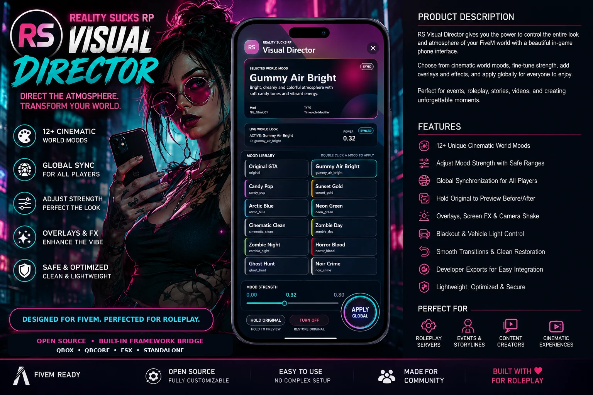

# RS Visual Director

<a href="https://reality-sucks-rp-webstore.tebex.io/package/7556700"></a>

Direct the mood of your world from an in-game phone. Authorized staff can choose from 12 cinematic looks, adjust their strength, compare against Original GTA and synchronize the result for connected players. Smooth fades, optional effects and developer exports support events and custom scenes.

The current listing asks owners not to use this on FiveM Enhanced during its early testing period.

[Download the original ZIP](https://github.com/RealitySucksRP/rs-visualdirector/releases/latest/download/rs-visualdirector.zip) | [Free on Tebex](https://reality-sucks-rp-webstore.tebex.io/package/7556700) | [Website](https://realitysucksrp.github.io/) | [Discord](https://discord.gg/e9V3rPHySx) | [YouTube](https://www.youtube.com/@RealitySucksRP) | [All free scripts](https://reality-sucks-rp-webstore.tebex.io/category/free-scripts)

**Install folder:** `rs-visualdirector`. Download the original ZIP to retain the package folder layout. Source, configuration, licenses and included assets are provided below.

<details>
<summary>More screenshots</summary>



</details>

## Package documentation

# RS Visual Director

At RealitySucksRP, we build cinematic FiveM resources around immersive roleplay, memorable scenes, and straightforward setup. **RS Visual Director** gives authorized staff a custom in-game phone for directing the visual atmosphere of the entire server.

The resource starts with the normal GTA/FiveM image. No custom mood is forced during startup.

## What players and staff can do

Open the phone, scroll through the mood library, select a world look, adjust its safe strength, and apply it globally.

Included features:

- 12 curated production moods
- Original GTA startup and instant restoration
- Server-synchronized visual changes
- Custom Gummy Air phone interface
- Two-column scrolling mood library with a visible side scrollbar
- Safe minimum and maximum strength for every mood
- Hold-to-compare Original GTA
- Smooth fade transitions
- Optional film, toxic, night, blood, paranormal, pursuit, scanline, and VHS overlays
- Optional screen effects, extra timecycles, camera shake, and blackout layers
- ACE-protected global controls
- Qbox, QBCore, ESX, and standalone bridge support
- Automatic framework and notification detection
- Optional job, framework-group, or identifier access
- Optional personal preferences and oxmysql persistence
- Developer exports for missions, events, horror, police, zombie, and cinematic integrations


## Installation

1. Keep the folder name exactly as:

```text
rs-visualdirector
```

2. Place it inside the server resources folder.

3. Add the following lines to `server.cfg`:

```cfg
ensure rs-visualdirector
add_ace group.admin rs-visualdirector.admin allow
```

4. Restart the server.

5. Open the phone with:

```text
/visualmenu
```

No framework is required. The bridge automatically detects Qbox, QBCore, ESX, or standalone mode.
Visual Director does not use inventory, target, banking, or item systems, so no unnecessary adapters or dependencies are loaded.

## Main commands

| Command | Purpose |
|---|---|
| `/visualmenu` | Opens the phone for authorized staff |
| `/vui` | Short menu alias |
| `/visual list` | Lists available production moods |
| `/visual <mood> [strength]` | Applies a synchronized mood |
| `/visual off` | Restores Original GTA for everyone |
| `/vcomfort` | Shows personal comfort settings |
| `/vcomfort overlays on/off` | Enables or disables NUI overlays locally |
| `/vcomfort screenfx on/off` | Enables or disables screen effects locally |
| `/vcomfort shake on/off` | Enables or disables camera shake locally |
| `/vcomfort blackout on/off` | Enables or disables blackout locally |
| `/vclose` | Emergency mouse/focus release |

## Included moods

- Gummy Air Bright
- Candy Pop
- Sunset Gold
- Arctic Blue
- Neon Green
- Cinematic Clean
- Zombie Day
- Zombie Night
- Horror Blood
- Ghost Hunt
- Police Chase
- Noir Crime

Experimental creator presets remain included but hidden by default.

## Framework bridge

The bridge is internal and does not add a required dependency.

Default configuration:

```lua
Config.Bridge = {
    framework = 'auto',
    notifications = 'auto',
    identifier = 'framework'
}
```

Supported framework values:

```text
auto, qbox, qbcore, esx, standalone
```

Supported notification values:

```text
auto, qbox, qbcore, esx, ox_lib, native
```

Automatic mode uses the active framework notification system first and falls back to the native GTA feed.

### Access control

ACE remains enabled and recommended by default:

```lua
Config.RequireAce = true
Config.Bridge.permissions.useAce = true
```

Optional framework administrator groups:

```lua
Config.Bridge.permissions.useFrameworkGroups = true
```

Optional job access with minimum grades:

```lua
Config.Bridge.permissions.useJobs = true
Config.Bridge.permissions.requireOnDuty = true
Config.Bridge.permissions.jobs = {
    police = 4,
    government = 0
}
```

Optional citizen ID or license access:

```lua
Config.Bridge.permissions.useIdentifiers = true
Config.Bridge.permissions.identifiers = {
    'ABC12345',
    'license:xxxxxxxxxxxxxxxxxxxxxxxxxxxxxxxxxxxxxxxx'
}
```

All enabled access methods are additive. A player only needs to pass one enabled method.

## Important production defaults

```lua
Config.DefaultStyle = false
Config.RequireAce = true
Config.DeveloperTools = false
Config.AllowPersonalOverride = false
Config.Database.enabled = false
Config.Menu.showExperimental = false
Config.Menu.showWindowLabels = false
```

## Optional personal mode

Allow players to keep a personal visual preference:

```lua
Config.AllowPersonalOverride = true
```

Preferences remain active for the current session. To save them across reconnects, start `oxmysql` and enable:

```lua
Config.Database.enabled = true
```

The table is created automatically. Framework identifiers use citizen IDs where available so separate characters can keep separate preferences.

## Server exports

```lua
-- Apply a permanent synchronized mood
exports['rs-visualdirector']:SetStyle('ghost_hunt', 0.60)

-- Restore Original GTA
exports['rs-visualdirector']:ClearStyle()

-- Read the synchronized state
local state = exports['rs-visualdirector']:GetState()

-- Apply a temporary scene mood
local ok, token = exports['rs-visualdirector']:PushStyle('police_chase', 15000, 0.55)

-- End the temporary mood early
if ok then
    exports['rs-visualdirector']:PopStyle(token)
end
```

Temporary mood tokens are revision-safe. An expired scene cannot restore an old mood after a newer manual change.

## Bridge exports

```lua
local info = exports['rs-visualdirector']:GetBridgeInfo()
local framework = exports['rs-visualdirector']:GetFramework()
local player = exports['rs-visualdirector']:GetBridgePlayer(source)
local identifier = exports['rs-visualdirector']:GetBridgeIdentifier(source)
local allowed = exports['rs-visualdirector']:HasVisualAccess(source)

exports['rs-visualdirector']:BridgeNotify(source, 'Visual mood applied.', 'success', 4000)
```

## Client exports

```lua
exports['rs-visualdirector']:ApplyLocalStyle('noir_crime', 0.70)
exports['rs-visualdirector']:ClearLocalStyle()

local style, strength = exports['rs-visualdirector']:GetActiveStyle()
exports['rs-visualdirector']:BeginOriginalCompare()
exports['rs-visualdirector']:EndOriginalCompare()

local bridge = exports['rs-visualdirector']:GetBridgeInfo()
exports['rs-visualdirector']:BridgeNotify('Preview enabled.', 'inform', 3500)
```

## Compatibility notes

RS Visual Director uses GTA/FiveM runtime timecycle natives. It does not include ENB, ReShade, VisualV, NaturalVision, replacement weather XML, `visualsettings.dat`, water files, lens flares, or another graphics overhaul.

Another resource that continuously forces its own timecycle may compete with Visual Director. Test character selection, death effects, drug effects, cameras, weather systems, and custom interiors on the target server.

When the mood is turned off or the resource stops, Visual Director clears its timecycle, extra timecycle, screen effect, camera shake, blackout state, NUI focus, and world overlay.

## License

The Lua, JavaScript, HTML, and CSS source code is released under the GNU General Public License v3.0 in `LICENSE`.

The RealitySucksRP name, RS branding, phone artwork, woman-phone artwork, and included promotional art remain RealitySucksRP brand assets. They may be used and modified as part of an installed or forked RS Visual Director resource, but may not be extracted and sold as standalone artwork or presented as another creator's branding. Server owners may replace the images with their own artwork.

